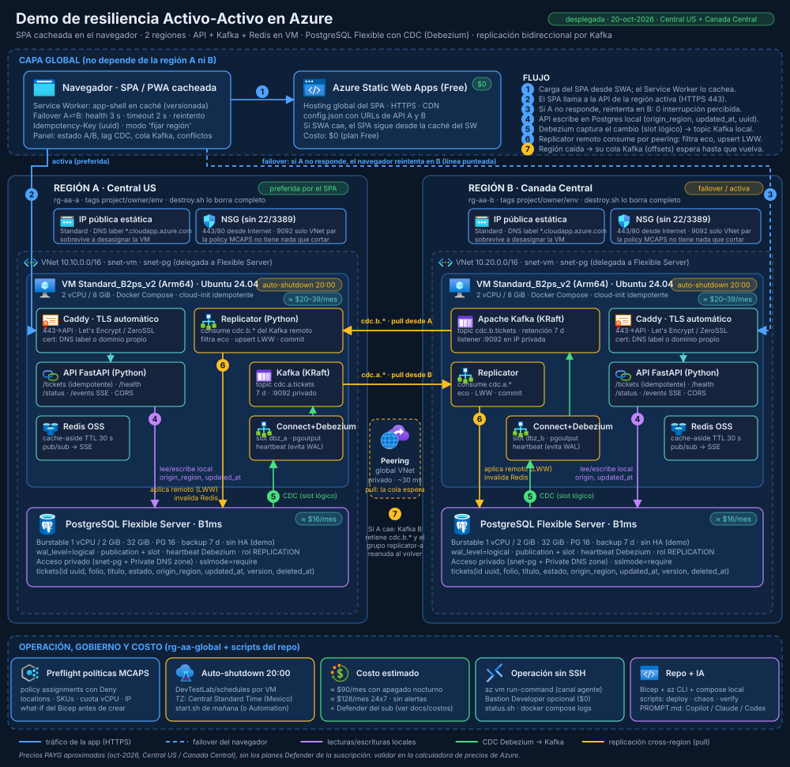

# Demo de resiliencia Activo-Activo en Azure

SPA cacheada en el navegador · 2 regiones de Azure · API + Kafka + Redis en una VM por región · PostgreSQL Flexible Server con CDC (Debezium) · replicación **bidireccional** por Kafka · failover con **0 interrupción percibida** · apagado automático a las 20:00.



Escenario: **"Registros"**, lo más simple posible: un formulario que guarda un texto en la región que elijas (automática, A o B) y un visor por región que muestra la tabla de cada base en vivo. Si la región A se apaga, el navegador sigue trabajando contra la región B sin que el usuario lo note; los cambios hechos en B quedan en la cola de Kafka B hasta que A vuelve y se sincroniza.

## Qué hay dentro

| Carpeta | Contenido |
|---|---|
| `infra/` | Bicep a nivel suscripción: 3 grupos de recursos, VNets con peering global, NSG sin puertos de gestión, VMs Ubuntu 24.04, PostgreSQL Flexible B1ms privado con `wal_level=logical`, Static Web App Free, auto-shutdown |
| `vm/` | Lo que corre en cada VM: `docker-compose.yml` (Caddy, API, Replicator, Redis, Kafka KRaft, Kafka Connect + Debezium, Kafbat UI), `Caddyfile`, conector Debezium y `configure.sh` |
| `services/api` | FastAPI: `/tickets` (CRUD idempotente), `/health`, `/status`, `/events` (SSE) |
| `services/replicator` | Aplicador Python: consume el CDC de la otra región, descarta eco, aplica LWW, invalida Redis |
| `web/` | SPA sin bundler + Service Worker (PWA) con failover en el cliente, selector de región de escritura y panel de resiliencia; `visor.html?region=a|b` muestra la tabla de cada base en vivo. La copia servida desde una VM prefiere su propia región y cae a la otra; `?reset=1` borra la caché local de la app en el navegador |
| `db/` | `schema.sql` (tabla `tickets`, heartbeat, publicación) |
| `scripts/` | `preflight`, `deploy`, `status`, `chaos`, `verify-sync`, `start`, `stop`, `destroy`, `seed`… |
| `docs/` | [Arquitectura](docs/architecture.md) · [Guion de la demo](docs/runbook-demo.md) · [Decisiones y camino a producción](docs/decisiones.md) · [Costos y políticas MCAPS](docs/costos-y-politicas.md) · [Propuesta original](docs/PROPUESTA.md) |
| `PROMPT.md` | Prompt listo para que GitHub Copilot, Claude Code o Codex levanten la demo en otra suscripción |

## Requisitos

- Azure CLI ≥ 2.60 con Bicep (`az bicep version`), sesión iniciada (`az login`) y permiso de *Contributor* en la suscripción.
- Node ≥ 18 (`npx`, para la SWA CLI), `jq`, `python3`, `openssl`, `ssh-keygen`, `curl`, `tar`, `base64`. Probado en macOS (bash 3.2) y Linux.
- No hace falta Docker local: las imágenes se construyen en las VMs. Para el hash de la contraseña de la consola de Kafka se usa Docker si está corriendo (`caddy hash-password`) y, si no, `htpasswd` (incluido en macOS; `apache2-utils` en Linux).

## Levantarlo en tu suscripción

```bash
az login
az account set -s "<nombre o id de la suscripción>"
# revisa deploy.env: regiones, VM_SIZE, zona horaria del apagado
./scripts/preflight.sh      # herramientas, proveedores, políticas, SKU/cuota, what-if (no crea nada)
./scripts/deploy.sh         # 15–25 min: Bicep → Postgres → VMs → CDC → SPA → prueba de humo
./scripts/status.sh         # estado de ambas regiones
```

`deploy.sh` imprime las URLs al terminar (también quedan en `.env.deploy`). El SPA se sirve en dos lugares: en Static Web Apps (global, `https://<SWA_HOST>`) y, como respaldo, desde cada región en `https://<VM_A_FQDN>/app/` y `https://<VM_B_FQDN>/app/` (mismo código y mismo failover en el cliente).

> La publicación en Static Web Apps usa la SWA CLI, cuyo binario `StaticSitesClient` es x64: en un Mac Apple Silicon hace falta Rosetta (o publicar desde Windows/Linux x64). Si no se puede, la demo funciona igual con las URLs `/app/` de las regiones. Luego `./scripts/seed.sh A 3` crea registros de ejemplo y [docs/runbook-demo.md](docs/runbook-demo.md) tiene el guion escena por escena.

Con un agente de IA: pega el contenido de [PROMPT.md](PROMPT.md) en GitHub Copilot, Claude Code o Codex con el repositorio abierto.

## Operación diaria

| Acción | Comando |
|---|---|
| Estado | `./scripts/status.sh` |
| Verificar que ambas bases son idénticas | `./scripts/verify-sync.sh` |
| Consola gráfica de Kafka (brokers, topics y mensajes, lag del grupo del par, conector Debezium) | `https://<VM_A_FQDN>/kafka-ui/` · `https://<VM_B_FQDN>/kafka-ui/` — usuario `demo` (`KAFKA_UI_USER` en `deploy.env`), contraseña en `.secrets/kafka_ui_password`; solo lectura (`KAFKA_UI_READONLY`). Para cambiar la contraseña: borra el archivo y reenvía el bundle |
| Caer / recuperar una región | `./scripts/chaos.sh stop-vm A` · `./scripts/chaos.sh start-vm A` (también `stop-db`, `stop-api`, `partition`, `heal`) |
| Reparar reglas de red si la gobernanza cambió el NSG de la subred | `./scripts/fix-subnet-nsg.sh` (lo invocan `start.sh` y `deploy.sh`) |
| Encender por la mañana | `./scripts/start.sh` (arranca también los PostgreSQL si están detenidos: la gobernanza de la suscripción MCAPS los detiene cada noche ~00:00 CDMX / 06:00 UTC) |
| Apagar | automático a las 20:00 (`TIME_ZONE`); manual `./scripts/stop.sh [--db]` |
| Reenviar código a las VMs | `./scripts/push-bundle.sh A` y `B` (luego `configure-cdc.sh` si cambió el esquema o el conector) |
| Republicar el SPA | `./scripts/deploy-web.sh` (Static Web Apps) · `./scripts/push-bundle.sh A` y `B` (copias `/app/` en las VMs) |
| Guion de la demo y guía de Kafka en línea | `https://<SWA_HOST>/docs/guion-demo.html` · `https://<SWA_HOST>/docs/kafka-guia.html` (también en `/app/docs/` de cada región). Se publican con los mismos comandos: los scripts copian `docs/*.html` a `web/docs/` (generado, fuera de git) |
| Borrar todo | `./scripts/destroy.sh` |

## Cómo funciona la replicación (resumen)

1. Cada escritura va a Postgres local con `origin_region`, `updated_at` (reloj del servidor) y un `id` uuid generado por el cliente.
2. Debezium captura el cambio por el slot lógico y lo publica en el Kafka local (`cdc.<región>.public.tickets`).
3. El Replicator de la **otra** región consume ese topic directamente del Kafka origen (peering privado). Sus offsets viven allí: si su región estaba caída, al volver reanuda donde iba.
4. Aplica un upsert con guarda LWW (`updated_at` más nuevo gana), invalida Redis y avisa por SSE. La vuelta del mismo cambio se descarta por `origin_region` (anti-eco).

Detalles y decisiones en [docs/architecture.md](docs/architecture.md) y [docs/decisiones.md](docs/decisiones.md).

## Seguridad y costo

- Sin SSH ni RDP: todo por `az vm run-command`. PostgreSQL solo privado. Kafka solo en la IP privada, consumido por el peering.
- La consola de Kafka (Kafbat UI) solo se expone por HTTPS en `/kafka-ui/` de cada región, con usuario y contraseña (hash bcrypt en Caddy, fuera de git) y en modo solo lectura. Corre en la misma VM: sin puertos nuevos ni costo extra.
- ≈ 90 USD/mes con apagado nocturno (≈ 128 24×7) sin contar los planes de Defender que imponga la suscripción. Detalle en [docs/costos-y-politicas.md](docs/costos-y-politicas.md).

## Licencia

MIT.
