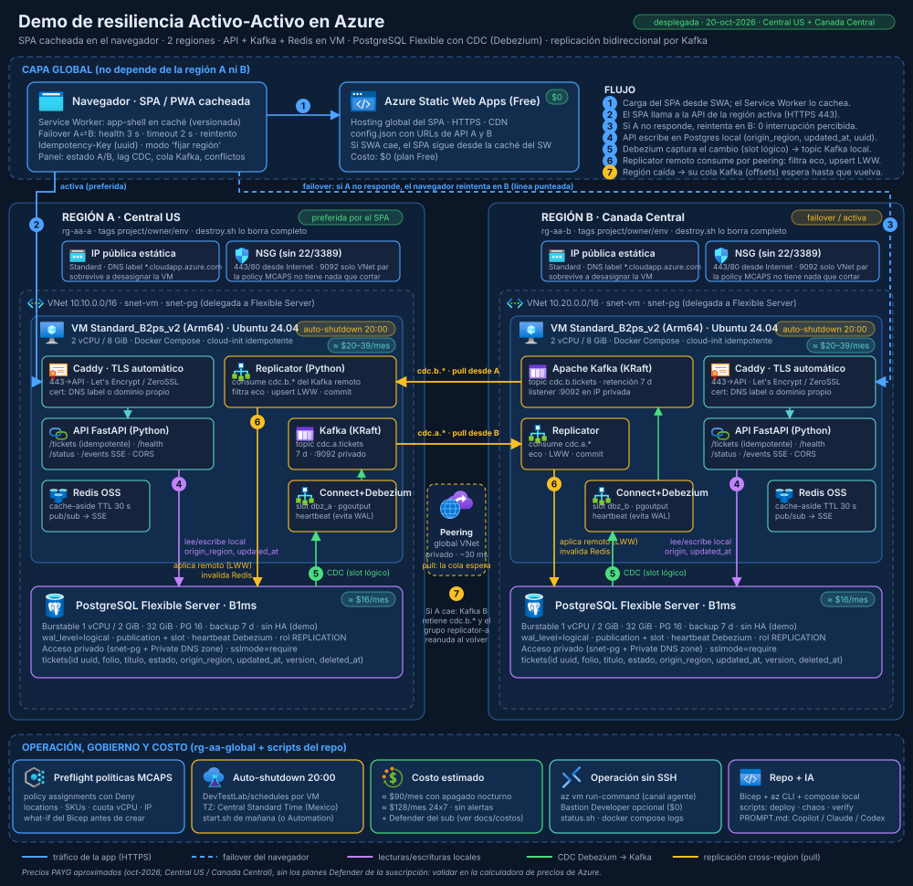

# Arquitectura

## Capas

| Capa | Componente | Implementación | Notas |
|---|---|---|---|
| Global | SPA / PWA | `web/` (HTML + JS sin bundler), `sw.js` cachea el app-shell | El failover vive en el navegador: sondea `/health` de A y B cada 3 s y reintenta en la otra región ante timeout, error de red o 5xx |
| Global | Hosting | Azure Static Web Apps **Free** (`infra/modules/swa.bicep`) y, como respaldo, Caddy sirve el mismo SPA en `/app/` de cada región | `web/config.json` (generado) lleva las URLs de las APIs. Si el hosting no responde, el SPA sigue desde la caché del Service Worker |
| Región | Entrada TLS | Caddy (`vm/caddy/Caddyfile`) | Certificado automático para el DNS label `*.cloudapp.azure.com` (Let's Encrypt, ZeroSSL como respaldo) |
| Región | API | FastAPI (`services/api/app.py`) | `/tickets` CRUD idempotente, `/health`, `/status`, `/events` (SSE). Escribe con `origin_region` y `updated_at = clock_timestamp()` |
| Región | Caché | Redis 7 (contenedor) | Cache-aside de la lista (TTL 30 s) y pub/sub para el SSE; el Replicator la invalida al aplicar cambios remotos |
| Región | Mensajería | Apache Kafka 3.9 (KRaft, 1 nodo) | Listener `EXTERNAL` solo en la IP privada de la VM (puerto 9092); retención 7 días |
| Región | CDC | Kafka Connect + Debezium PostgreSQL (`vm/connect/connector.json.tpl`) | Plugin `pgoutput`, publicación `dbz_pub`, slot `dbz_<región>`, heartbeat cada 10 s |
| Región | Consola de Kafka | Kafbat UI 1.5 (`ghcr.io/kafbat/kafka-ui`, arm64) | Caddy la publica en `/kafka-ui/` con `basic_auth` (usuario `KAFKA_UI_USER`, hash bcrypt `KAFKA_UI_HASH`, ambos del `.env` de la VM); solo lectura, heap 400 MB. Brokers, topics y mensajes, grupos con lag, Kafka Connect |
| Región | Aplicador | Replicator (`services/replicator/replicator.py`) | Consume el topic de la **otra** región desde **su** Kafka (pull por peering), descarta eco, aplica LWW, invalida Redis, publica SSE |
| Región | Base de datos | Azure Database for PostgreSQL Flexible Server B1ms, acceso privado (`infra/modules/region.bicep`) | `wal_level=logical`, rol con `REPLICATION`, `REPLICA IDENTITY FULL` (`max_slot_wal_keep_size` es de solo lectura en Flexible Server) |
| Red | VNet por región + peering global + NSG + IP pública estática | `infra/modules/region.bicep`, `peering.bicep` | Solo 443/80 desde Internet y 9092 desde la VNet par. Sin 22/3389 |
| Operación | Auto-shutdown 20:00, `run-command`, scripts | `Microsoft.DevTestLab/schedules`, `scripts/` | Sin SSH; estado local en `.env.deploy` |

## Flujo de un cambio (A → B)

1. El navegador hace `PUT /tickets/{uuid}` a la API de A (el uuid lo genera el cliente: reintentar no duplica).
2. La API escribe en Postgres A: `origin_region='a'`, `updated_at=clock_timestamp()`, `version+1`; invalida Redis y publica el evento SSE.
3. Debezium A lee el slot lógico `dbz_a` y produce el evento en `cdc.a.public.tickets` (Kafka A).
4. El Replicator de B consume `cdc.a.public.tickets` **desde Kafka A** (peering, IP privada). Sus offsets (`replicator-b`) viven en Kafka A.
5. Aplica un upsert con guarda LWW en Postgres B; invalida Redis B; publica el evento SSE en B. Commit del offset **después** de aplicar.
6. Debezium B captura esa fila (con `origin_region='a'`) y la publica en `cdc.b.public.tickets`; el Replicator de A la descarta como **eco** (`origin_region == 'a'`).

## Cuando cae la región A

- El SPA detecta el fallo (timeout 1.5 s en `/health` o 2.5 s en la llamada) y conmuta a B. La llamada en curso se reintenta en B de inmediato.
- Las escrituras en B siguen generando eventos en Kafka B. El grupo `replicator-a` no consume: `/status` de B muestra `outbound_pending` creciendo ("cola para A").
- Al volver A, el Replicator de A reanuda desde su último offset en Kafka B y drena la cola; `scripts/verify-sync.sh` confirma que ambas bases quedan idénticas.
- Lo que A escribió justo antes de caer y B no alcanzó a consumir llega cuando A vuelve (el log de Kafka A está en disco): es la ventana RPO del activo-activo asíncrono.

## Conflictos

`INSERT … ON CONFLICT (id) DO UPDATE … WHERE EXCLUDED.updated_at > tickets.updated_at OR (EXCLUDED.updated_at = tickets.updated_at AND EXCLUDED.origin_region < tickets.origin_region)`: gana la última escritura por reloj del servidor Postgres; empate → región alfabéticamente menor. Los borrados son lógicos (`deleted_at`) para que también sigan LWW.

## Lo que no replica

DDL (Debezium solo captura DML). El esquema vive en `db/schema.sql` y `vm/configure.sh` lo aplica en ambas regiones.
